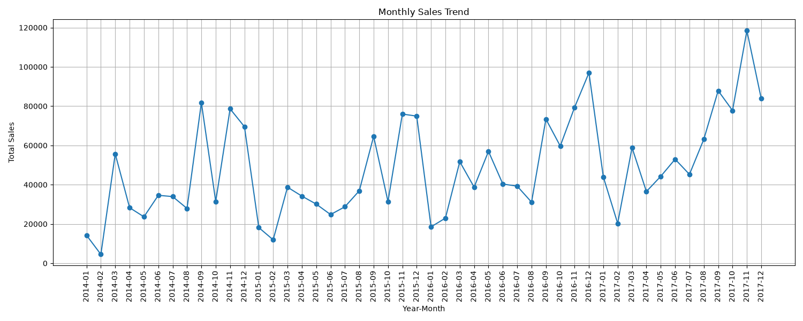
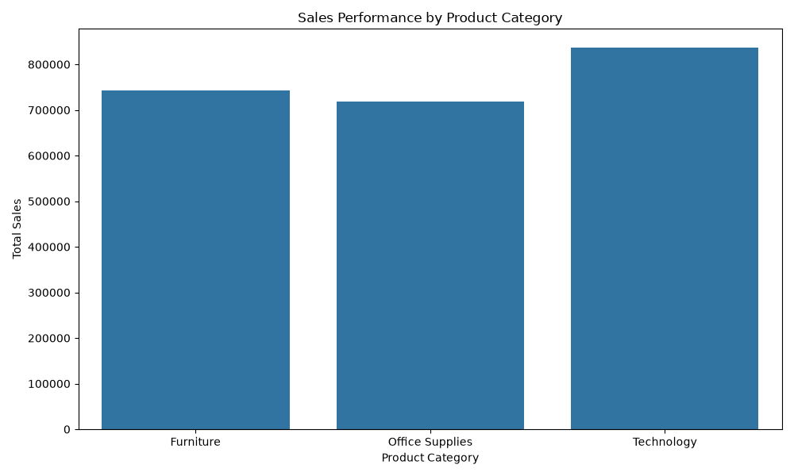
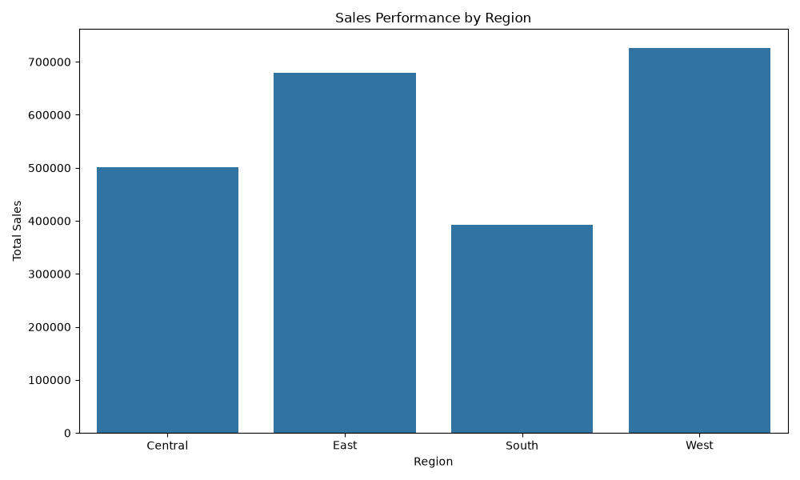
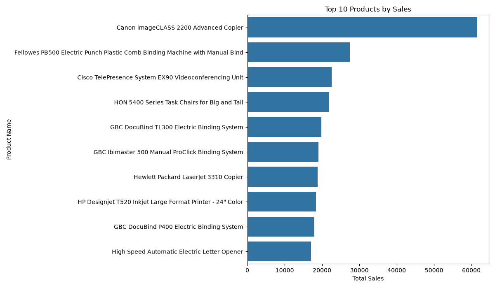
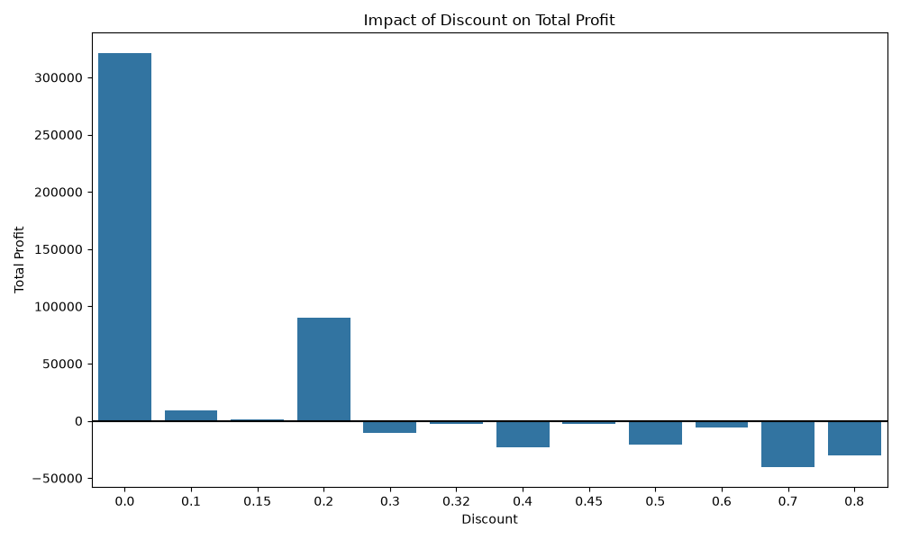
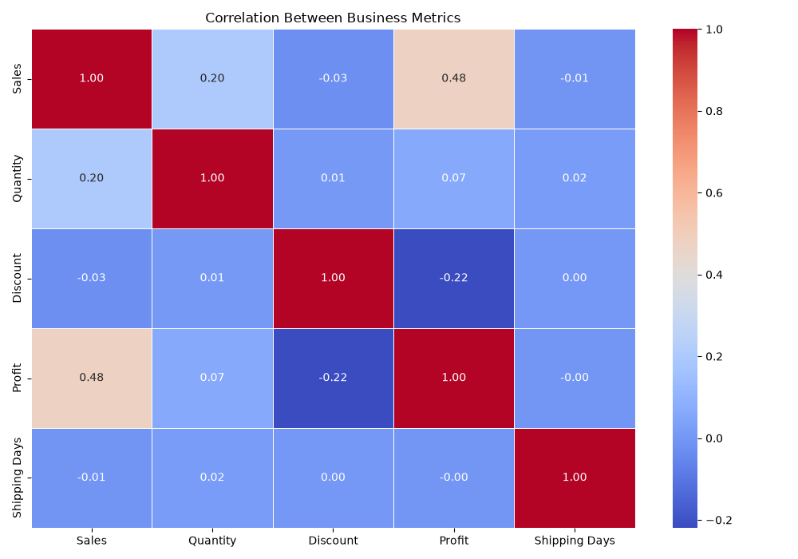

# E-Commerce Sales Analysis | Python Data Analytics Project

## Project Overview

An exploratory data analysis project using the Sample Superstore dataset to understand sales performance, profitability, customer behavior, product performance, and shipping operations.

The goal is to identify business trends, discover loss-making products, and generate actionable business recommendations.

## Tools & Technologies

- Python 3
- Jupyter Notebook
- Pandas – Data manipulation and analysis
- NumPy – Numerical operations
- Matplotlib – Data visualization
- Seaborn – Statistical visualization

## Dataset Information

- Dataset: Sample Superstore
- Total Records: 9,994
- Total Columns: 21

## Project Structure

```text
ecommerce-sales-analysis/
├── data/
│   ├── raw/
│   └── processed/
├── notebooks/
│   └── 01_sales_analysis.ipynb
├── outputs/
│   └── charts/
├── reports/
│   └── final_business_report.md
└── README.md
```

## Key Performance Indicators (KPIs)

| Metric | Value |
|---|---:|
| Total Sales | 2,297,200.86 |
| Total Profit | 286,397.02 |
| Total Orders | 5,009 |
| Total Quantity Sold | 37,873 |
| Average Order Value | 458.61 |
| Profit Margin | 12.47% |

## Project Visualizations

### 1. Monthly Sales Trend


### 2. Category-wise Sales


### 3. Regional Sales Performance


### 4. Top 10 Products by Sales


### 5. Discount vs Profit Analysis


### 6. Correlation Heatmap


## Analysis Performed

1. Data loading and exploration
2. Data cleaning and preprocessing
3. Overall sales and profit analysis
4. Category-wise analysis
5. Region-wise analysis
6. Monthly sales trend analysis
7. Product performance analysis
8. Customer analysis
9. Loss-making product analysis
10. Sub-category performance analysis
11. Discount vs Profit analysis
12. Shipping performance analysis
13. State-wise sales and profit analysis
14. Correlation analysis

## Key Business Findings

- Technology generated the highest category-level profit.
- West was the highest-performing region in sales and profit.
- Tables was the most loss-making sub-category, with a loss of 17,725.48.
- Some high-sales products generated negative profits.
- Discount strategy and product profitability need further investigation.

## Business Recommendations

- Review pricing and discount strategies.
- Investigate loss-making products and sub-categories.
- Focus on profitable product categories.
- Study high-performing regions for growth opportunities.
- Develop customer retention strategies.

## How to Run This Project

1. Clone or download this repository.
2. Install the required Python libraries:

```bash
pip install -r requirements.txt
```

3. Open the project folder.
4. Launch Jupyter Notebook:

```bash
jupyter notebook
```

5. Open `notebooks/01_sales_analysis.ipynb` and run the cells.

## Project Status

Completed — Exploratory Data Analysis (EDA).

## Author

Data Analytics Portfolio Project